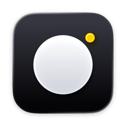

<p align="center">
  
</p>

<h1 align="center">Camdeck</h1>

<p align="center"><b>Webcam controls for Mac</b></p>

A small, free Mac app to adjust your USB webcam: zoom, move the view, fix brightness and colors, and keep yourself centered in frame. Works with the Insta360 Link 2C and most other USB webcams.

It's a light, open source alternative to the apps that come with Insta360, OBSBOT and Opal cameras.

## Why

Each camera brand ships its own heavy control app, and it only works with that brand. Camdeck is one small app for many cameras. There's nothing to install besides the app itself, and it doesn't run in the background unless you want it to.

## What you can do

- **See a live preview**, flip it like a mirror, and pick the video quality.
- **Fix the picture**: brightness, contrast, colors, sharpness, focus and flicker.
- **Control exposure**: let the camera decide, or set it yourself.
- **Zoom and move the view** with a simple draggable pad.
- **Auto framing**: the app follows your face and keeps you centered.
- **Save presets**: store your favorite settings and bring them back with one click.
- **Spot blown-out highlights** with the zebra stripe overlay.
- **Use Mac video effects** like Portrait, Studio Light and Background.
- **Run from the menu bar** and open at login, if you like.

## Which cameras work

Almost any USB webcam works for the basics (picture, exposure, zoom, focus, color). That includes Logitech Brio and C920, Elgato Facecam, Razer Kiyo and Anker PowerConf.

Some cameras get extra features:

| Camera | Status |
| --- | --- |
| Insta360 Link 2C | Fully tested, with extras like digital pan/tilt, HDR and shutter speed |
| Insta360 Link 2, Link | Should work, not tested yet |
| AnkerWork C310, PowerConf C200 | Early support, not tested on real hardware |
| OBSBOT Tiny 2, Tiny SE, Meet | Planned |
| Opal Tadpole, C1 | Planned |

Own a camera that isn't listed? [Open an issue](https://github.com/thevrus/camdeck/issues) and we'll look at adding it.

## Common questions

**Do I still need the camera maker's app?**
No. You can uninstall it.

**Will it work in Zoom, Google Meet, Teams and OBS?**
Yes. Settings are saved on the camera itself, so every app sees the same picture.

**Does it install a driver?**
No. Nothing is added to your system.

**What Mac do I need?**
A Mac running macOS 26. It works on Apple Silicon.

## Install

1. [Download the latest Camdeck.zip](https://github.com/thevrus/camdeck/releases/latest) and double-click it.
2. Drag **Camdeck** into your Applications folder.
3. Open it. The first time, macOS may say it can't verify the app. Right-click Camdeck, choose **Open**, then **Open** again. (On macOS 26 you may need System Settings → Privacy & Security → **Open Anyway**.) You only do this once.
4. Allow camera access when asked, plug in your webcam and go.

Camdeck updates itself. When a new version is out, it downloads and installs quietly. You can also choose **Camdeck → Check for Updates…** any time.

## License

MIT. Free to use and share.

---

# For developers

## How it works

```
App (SwiftUI, AutoFramer)
    │  capabilities only: Zoom, Reframe, Exposure, ImageControls…
    ▼
Camera (composed per device)
    ▲  most specific driver wins per capability
    │
    GenericUVCDriver   standard UVC, from the descriptor
    ProfileDriver      JSON profile for simple vendor controls
    Code drivers       Swift, for protocols that need logic
    │
    ▼
UVCTransport (IOKit EP0, rate limited, forbidden selector guard)
```

The app never knows which camera is attached. It asks for capabilities, drivers provide them, and USB safety rules live in one place. Camdeck speaks UVC directly over user-space USB control requests, with no kernel extension or daemon.

Details in [docs/adr-001-camera-drivers.md](docs/adr-001-camera-drivers.md). Link 2C protocol notes are in [docs/link2c-protocol.md](docs/link2c-protocol.md).

## Build and test

You need macOS 26 and Xcode 26.

```sh
make app      # builds build/Camdeck.app
make run      # builds and opens it
make test     # runs the UVCKit test suite
```

The `uvcctl` command line tool dumps camera descriptors and reads or writes controls. Use it when adding support for a new camera.

## Shipping an update

Updates use [Sparkle](https://sparkle-project.org). The signing key lives in the maintainer's keychain; the feed is `appcast.xml` in this repo.

```sh
make release VERSION=0.2.0   # build, sign, update appcast.xml, publish a GitHub Release
```

## Adding a camera

1. Plug it in and run `uvcctl` to dump its descriptor.
2. Standard controls already work.
3. Map simple vendor controls in a JSON profile. Schema in [docs/profile-schema.md](docs/profile-schema.md).
4. Write a code driver only for features that need logic.
5. Add the descriptor as a test fixture.
